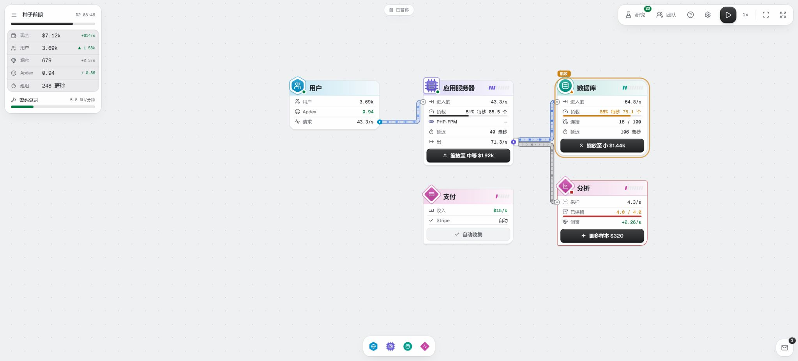

**简体中文** | [English](README.en.md)

# Quorum 中英双语版

> 本项目 Fork 自 [elianiva/quorum](https://github.com/elianiva/quorum)，原作者为 Dicha Zelianivan Arkana（elianiva）。[InSnocent/quorum](https://github.com/InSnocent/quorum) 于 2026-11-03 加入简体中文 / English 切换，沿用 GPL-3.0-or-later。原 LICENSE、作者归属和第三方许可均予以保留，修改说明见 [MODIFICATIONS.md](MODIFICATIONS.md)。

标题页右上角和游戏设置中均可切换语言，选择会保存在浏览器中。 当前中文译文是可游玩的初稿，已完成插值校验和基础术语检查，完整人工精校将继续进行。精校入口为 `scripts/localization/overrides.json`，维护方法见 [本地化说明](docs/localization.md)。中文版文案由本地 Index-Translate-2B 辅助生成并校对；游戏运行和构建不需要翻译模型。工程设计文档和原始示意截图保留上游版本，便于对照。

<p align="center">
  
</p>

<p align="center">
  <b>一款面向软件工程师的系统渐进式游戏。</b><br />
  上游演示：<a href="https://quorum.elianiva.com">quorum.elianiva.com</a>（原版）。
</p>

---

你在车库里创办一家初创公司，起步只有一台虚拟机。用户发送请求。你将组件连接到板上，为每个服务器选择语言和运行环境，然后依次解决一个又一个瓶颈，直到公司能够服务数十亿用户并上市。

每种机制都模拟了真实行为。PHP-FPM 工作进程等待数据库响应。Node.js 事件循环因 bcrypt 而停滞。JVM 在热身前速度缓慢。缓存重启时会引发惊群。平均性能掩盖了 p99 值。如果你曾在凌晨 3 点被告警叫醒，就会对这些问题很熟悉。你需要依据指标来解决它们。


## 游戏玩法

### 从小处开始

第一家公司的结构包括一个用户节点、一个应用服务器、支付模块和分析模块。请求通过你绘制的链接流动。成功处理的请求会赚取现金，现金会等待在支付抽屉中，直到你收集它。分析模块会采样流量并将其转化为洞察，即研究货币。


### 找到瓶颈

模拟是一个流量网络。在任何时刻，一个节点会限制最大收入，而板面会标记它。卡片上说明原因：CPU、CPU 积分、内存、工作进程或连接资源不足。每种限制需要不同的修复方法，更多硬件修复只能解决其中一部分。

每次修复都会移动瓶颈。更快的应用服务器会向数据库发送更多查询。缓存可以减轻数据库负载并增加陈旧读取量。只读副本会增加读取容量，也会引入复制延迟。不断迁移的瓶颈，就是游戏的核心内容。

### 选择技术栈，而非层级

没有任何选项能严格优于其他选项。每个应用服务器运行一个技术栈：运行时与框架。Go 能以低成本处理大量空闲连接，其垃圾收集器在堆满时会占用 CPU。Rust 运行快，但开发耗时较长。PHP-FPM 每次请求的开销较高，但请求间不会累积内存泄漏。正确的选择取决于你的架构设计。

<p align="center">
  
</p>

### 研究、融资、再循环

洞察可以购买研究：新的组件、运行时变体、技术以及更多可见性。Apdex 高于当前阶段的目标时，用户会增长；低于目标时，用户会流失。


在每个里程碑阶段，投资者会提供融资轮次：现金换股权。每个时代都会带来新的请求类型，以不同方式打破原有设计。

| 阶段     | 晋级条件                  | 新请求类型                | 新挑战                                |
| -------- | ------------------------- | ------------------------- | ------------------------------------- |
| 车库期   | 1,000 用户                | `page`、`read`            | CPU、内存耗尽                         |
| 种子前期 | 5,000 用户                | `write`、`login`          | 数据库竞争、连接数、CPU 密集任务      |
| 种子期   | 25,000 用户               | `search`、`upload`、`bot` | 混合负载、滥用、大体积请求            |
| A 轮     | 150,000 用户              | `media`、`rt`、`buy`      | 可用区故障、出口流量费用、资金正确性  |
| B 轮     | 1,000,000 用户            | `job`、`report`、`ai`     | OLTP 与 OLAP 竞争、GPU 成本、团队扩张 |
| C 轮     | 10,000,000 用户           | `feed`、`hook`、`push`    | 扇出、热点键、跨地域与区域故障        |
| 上市前   | 50,000,000 用户并完成 IPO | —                         | 合规、灾难恢复、利润率                |
| 已上市   | 无尽模式                  | —                         | 季度业绩指引                          |

### 应对事件

故障调度器会考验架构最薄弱的部分：可用区中断、缓存惊群、重试风暴或 CVE。每次故障结束后都会生成复盘及一个改进项。亲自处理过某类故障后，就能为它编写应急预案。


### 阅读邮件

建议、报价单、发票、CVE 披露和垃圾邮件会作为来自游戏内人物和系统的信件进入收件箱。有些带有行动按钮，有些则是陷阱。

<p align="center">
  
</p>

### 退出并重新开始

公司可以通过人才收购、并购、IPO 或创始人退任结束经营。股权比例乘以估值决定传承收益。传承用于购买永久加成，保存的架构方案可以带到下一家公司。退出还会解锁金融科技、流媒体、AI 等创业方向，以及提高难度、增加传承奖励的规则修正项。

### 公司之外

- **沙箱。** 引导式沙箱会教你一个固定设计中的机制，例如连接数限制、缓存惊群、GC 暂停或热点键。自由沙盒中所有功能都已解锁。
- **挑战。** 固定的谜题，根据成本、尾部延迟和复杂度评分。服务器会重新运行每次重演，并将你的结果放在每位玩家最佳表现的直方图中。你只会看到百分位，不会看到排名。

## 了解更多

- [游戏设计文档](docs/gdd/README.md) — 完整的设计，从模拟到平衡。
- [现实检查](docs/gdd/reality-check.md) — 每条规则背后的真实行为。
- [工程术语表](docs/gdd/glossary.md) — 游戏所教的工程术语。
- [CONTEXT.md](CONTEXT.md) — 代码和界面文案使用的游戏词汇。
- [docs/adr](docs/adr) — 设计和代码背后的决策。

## 开发

Quorum 基于 Cafe 构建：**C**loudflare 用于运行时，**A**lchemy 用于基础设施，**F**oldkit 用于 UI，**E**ffect 用于服务器和共享合约。

| 路径                  | 内容                                                 |
| --------------------- | ---------------------------------------------------- |
| `apps/web`            | Foldkit 游戏客户端、网站工作进程和静态资产。         |
| `apps/backend`        | Effect RPC 处理程序以及 API 工作进程入口。           |
| `packages/simulation` | 纯模拟模块。浏览器运行它；API 工作进程重新运行它。   |
| `packages/rpc`        | 通信合约：RPC 组、schema、声明错误和 API 前缀。      |
| `examples/reference`  | Foldkit 查询到 RPC 示例，仅部署在 `reference` 阶段。 |

Alchemy 将网站和 API 组合成一次部署。服务绑定将相同来源的 API 请求路由到后端。

### 开始使用

要求：Node.js 24.11 或更高版本和 pnpm 12。

```sh
pnpm install
pnpm dev            # 默认栈
pnpm dev:reference  # 参考示例
```

### 验证更改

```sh
pnpm check      # Vite+ 格式检查和代码规范
pnpm typecheck
pnpm test
pnpm build
```

提交前运行 `pnpm check`，推送前运行类型检查和测试。

### 部署

本 Fork 默认关闭 CI 自动部署。需要部署时，在自己的 Cloudflare 账户配置 `CLOUDFLARE_API_TOKEN` 和 `CLOUDFLARE_ACCOUNT_ID`，并将仓库变量 `ENABLE_DEPLOY` 设为 `true`。自定义域名通过 `PRODUCTION_DOMAIN` 配置，CI 环境链接通过 `PRODUCTION_URL` 配置。未配置域名时使用 Cloudflare 分配的地址。

`pnpm deploy` 会创建或更新 Cloudflare 资源，应由维护者在配置完成后主动执行。此汉化任务没有部署线上服务。上游演示站由原作者维护，仍是上游版本。

### 艺术

社交卡 `apps/web/public/og.png` 是 `apps/web/art/og.html` 的截图，而 README 主图 `docs/images/hero.png` 是 `apps/web/art/hero.html` 的截图。每个文件都说明如何重新渲染它。`docs/images` 中的其他图片是运行游戏的截图。

### 设计说明

- [架构](docs/architecture.md) — 应用和 RPC 边界。
- [工具链](docs/tooling.md) — Vite+、Turbo 和 Oxfmt/Oxlint 的职责。
- [防护规则](docs/guardrails.md) — 强制执行的规则和检查。
- [添加功能](docs/extending.md) — 从合约到处理程序再到 UI 的路径。
- 参考示例故意与游戏分开。可以从中复制模式，但不要将它的演示行为移入默认应用中。

## 许可证

Quorum 采用 [GNU 通用公共许可证 v3.0 或更高版本](LICENSE) 许可。
